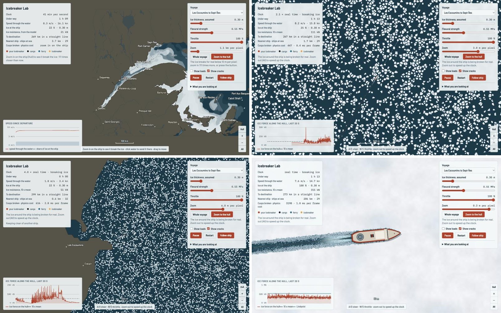

# Icebreaker Lab

A fast, top-down simulation of a ship breaking sea ice, in two versions:

- **A browser page** ([live page](https://pierrelucbacon.com/icebreaker-lab/)): a 76 m icebreaker on a voyage through the ice and traffic of the St. Lawrence. Zoom out and you see the whole Gulf; zoom in on the ship and you see its hull break the ice, with a live trace of the ice force. Click the water to send the ship somewhere, or steer with A/D and W/S when you are close.
- **A JAX environment** (`icebreaker_jax.py`): the continuous-sheet physics with fixed array shapes, so `reset` and `step` jit-compile and vmap over thousands of environments.

## Two scales

| | Hull scale | Route scale |
|---|---|---|
| Code | `icebreaker-core.js`, `icebreaker_jax.py` | `stlnav/` |
| Domain | 600 m × 240 m, 0.5 m grid | Estuary and Gulf of St. Lawrence, 2 km grid |
| Step | 0.2 s (physics at 360 Hz) | 60 s |
| Ice | A sheet that the hull crushes and bends | Concentration and thickness fields from the Canadian ice-ocean forecast (CIOPS-East) or ice charts |
| Ship | 3 degrees of freedom, forces on the waterline | A point with a heading; speed from a force balance fitted to the hull-scale runs (icebreaker) or from Lindqvist's formula (other ships) |
| Other ships | none | Generated traffic on real routes |
| Action | [throttle, rudder]; throttle 1 is full ahead, negative is astern | [throttle, turn]; the same throttle, with negative values counted as 0 |

The route-scale environment is described in [docs/st-lawrence-plan.md](docs/st-lawrence-plan.md) (section "What is built"), with what is sourced and what is a placeholder. Neither scale has been compared with measurements, so the transit times it gives are model output. To check and run it:

```bash
uv run --no-project --python 3.12 --with jax --with numpy python checks/stlnav_checks.py data/fields_20261117.npz
```

```bash
uv run --no-project --python 3.12 --with jax --with xarray --with 'netCDF4<1.7.5' --with scipy --with matplotlib python -m stlnav.demo --cache data/fields_20261117.npz --ice data/ice_hist/sic_2026-02-15.nc
```

`data/` is not in the repository: the fields come from the archive that `archiver/stl_archive.py` builds on the Mila cluster.

### How the two scales are linked


*a. Speed the icebreaker holds in level ice (an unbroken sheet of one thickness) at three throttles. Points: hull-scale runs, mean of 3, with bars of one standard deviation that are mostly smaller than the markers; open markers at zero are runs where the ship stopped. Solid lines: the route-scale model, fitted to those runs. Dashed lines: Lindqvist's formula alone, which the route-scale model used before. b. The same voyage at route scale with and without the fit; the ice is a chart of concentration with one assumed thickness. c. That voyage on the map. d. The hull-scale simulator run in the ice of the marked place.*

`stlnav/hullscale.py` links the two simulators in both directions.

**From hull scale to route scale.** The hull-scale ship is run in level ice at 7 thicknesses and 8 throttles, 3 runs each (panel a). More runs find the throttle below which it stops, and its speed in the channel left by another icebreaker. These runs are reduced to a table, `stlnav/tables/icebreaker.json`, that the route-scale speed model reads:

| Ice thickness (m) | 0.2 | 0.3 | 0.45 | 0.6 | 0.8 | 1.0 | 1.2 |
|---|---|---|---|---|---|---|---|
| Ice resistance at 4 m/s, as a multiple of Lindqvist's formula | 0.75 | 0.79 | 0.86 | 0.89 | 0.86 | 0.90 | 0.91 |
| Lowest throttle at which the ship keeps moving | 0.04 | 0.08 | 0.15 | 0.22 | 0.34 | 0.52 | 0.82 |
| The same according to Lindqvist's formula | 0.04 | 0.06 | 0.10 | 0.14 | 0.21 | 0.29 | 0.38 |
| Resistance in another icebreaker's channel, as a share of unbroken ice | 0.79 | 0.73 | 0.65 | 0.63 | 0.57 | 0.56 | 0.52 |

Three things come out of the hull-scale runs that the formula did not give:

- At 4 m/s the moving ship meets 75 to 91% of the resistance in the formula, so it is faster. The multiple also varies with speed (in thick ice it reaches 1.0 near the speed at which the ship stalls), and the table stores it for every thickness and speed.
- In thick ice the ship stops at a much higher throttle than the formula says: 0.82 against 0.38 in 1.2 m of ice. The mean resistance does not explain this. A ship that moves slowly is brought to rest by a single load peak and then cannot break the sheet from rest.
- In the channel of another icebreaker the resistance is 52 to 79% of that in unbroken ice. The route-scale model used a placeholder of 40%, so convoys are slower than before.

How well the route-scale model then agrees with the hull-scale simulator (`checks/two_scales.py`, 10 checks, all passing):

| Case | Fitted model | Lindqvist's formula alone |
|---|---|---|
| The 46 thickness and throttle pairs it was fitted to: mean and largest difference in speed | 0.2%, 2.3% | 7.0%, 17.7% |
| New runs between those pairs, ice of 0.25 and 0.5 m | 0.9%, 1.7% | 4.7%, 6.2% |
| New runs between those pairs, ice of 0.7, 0.9 and 1.1 m | 5.6%, 9.0% | 8.5%, 15.5% |
| Of 168 runs, 27 stop: runs where route scale disagrees | 3 | 24 |
| Speed in another icebreaker's channel, new runs | 1.2%, 2.6% | |
| Flexural strengths of 0.40 and 0.70 MPa (the fit is at 0.55) | 0.7%, 2.2% | |

In ice of 0.7 m and more, the differences of 5 to 9% at new points are not noise: in that check the two hull-scale runs of each case differ by 2.1% at most. The hull-scale resistance varies with thickness in ways that a table of 7 thicknesses does not follow. A finer table needs more runs, about 3 minutes of laptop time per added thickness.

**From route scale to hull scale.** `zoom` reads the ice at a place and time of a route-scale world and runs the hull-scale simulator in level ice of that thickness (panel d):

```python
from stlnav import hullscale
z = hullscale.zoom(env, world, lon, lat, t, thr=1.0)     # env, world: a stlnav environment whose class 0 is the icebreaker
z["hull_speed"], z["route_speed"], z["usable"]            # the two speeds for the same case, and whether the hull-scale run represents the local ice
```

**What the link does not cover.**

- Concentration. The hull-scale JAX simulator has no floes, so it is a continuous sheet or nothing. The route-scale model still scales resistance by concentration squared, which is a placeholder, and `zoom` marks places under 90% concentration as not usable.
- The other ship classes. The hull-scale simulator has one hull, so the merchant ships keep Lindqvist's formula. They use the icebreaker's channel values, which is optimistic for ships wider than the channel.
- Thickness that varies within a 2 km cell, ridges, and wind at hull scale.
- How fast the speed responds. The hull-scale ship's mass and force balance give a response time of about 13 s (computed, not measured); the route-scale model uses a time constant of 120 s.

To remake the table (about 25 minutes on a laptop), check the link (about 6 minutes) and redraw the figure:

```bash
uv run --no-project --python 3.12 --with jax --with numpy python -m stlnav.hullscale
```

```bash
uv run --no-project --python 3.12 --with jax --with numpy python checks/two_scales.py data/fields_20261117.npz
```

```bash
uv run --no-project --python 3.12 --with jax --with xarray --with 'netCDF4<1.7.5' --with scipy --with matplotlib python -m stlnav.demo_scales
```

The table records the hull-scale constants it was measured with. If one of them changes, importing `stlnav` warns that the table is out of date and the first check fails.

### In the browser



*One view at four zooms. Top left: the Gulf, at 41 minutes per second, with the coast, lakes, rivers and towns. Top right: 3 m per pixel, where the ice-breaking simulator moves the ship; the window is full of floes made from the chart, and only those near the ship are bodies. Bottom left: leaving Les Escoumins, at 6 m per pixel. Bottom right: the hull in level ice, in real time.*

The page is one view of one ship on one clock. The camera sits on the map and zooms from the whole Gulf (1 km per pixel) down to the hull (a few centimetres per pixel). Which simulator moves the ship follows the zoom:

| | Far out | Close to the ship (under 10 m per pixel) |
|---|---|---|
| What moves the ship | the route-scale model, `stlnav-core.js` | the ice-breaking simulator, `icebreaker-core.js` |
| Clock | 30 times real time up to 2 hours per second, faster the further out | 1 to 4 times real time |
| Ice | the chart, as a colour (beyond 22 m per pixel) | single floes and level ice made from the chart, across the whole window; near the ship they are bodies that break |

A slider and two buttons, "Zoom to the hull" and "Whole voyage", move between the two ends; the page says how much closer the view has to be for the ice to break.

The clock has to follow the zoom. Breaking ice is computed 360 times per second of the ship's time, which a browser manages at about the speed of a clock, and a voyage lasts 11 hours. Far out, the ship therefore moves with the model that the section above fits to the ice-breaking computation, so its speed does not jump when the two swap: in one run, the model had the ship at 7.48 m/s in 90% ice of 0.30 m, and the ice-breaking simulator held 7.46 to 7.49 m/s after taking over.

**The same ice everywhere, bodies only near the ship.** The ice-breaking simulator used to hold one fixed sheet 1,100 m long. For the page it has a scenario, `field`, in which the ice is one pattern laid over an endless plane. The plane carries a lattice of 40 m with one site per cell, and each site owns the ground nearer to it than to any other site. Where the chart shows 90% of ice or more, that ground is level ice, and neighbouring grounds make one sheet. Below that the site holds a floe: its ground, shrunk about the site. Not every site has a floe, the floes differ in size, and the ice is denser in some patches than in others, so that over a few hundred metres the floes cover the chart's share of the water (0.104 measured for 0.10 asked, 0.513 for 0.50, 0.815 for 0.85).

The pattern is a function of the place, so two things can read it. The simulator turns it into bodies near the ship, in squares of 256 m that are made when the ship comes near (within 190 m for floes, 420 m for level ice) and dropped when it is far away. The page paints the same pattern into tiles for the rest of the window, with the same shading. A floe therefore does not change when the ship comes near and it becomes a body, and the window is full of ice at any zoom under 14 m per pixel: there is no disc of ice around the ship any more. Where the ship has been, the channel is drawn over the tiles. Between 14 and 22 m per pixel the floes fade into the chart's colour.

The ship starts inside the ice with a channel astern. `checks/field.js` (4 checks, all passing) compares the scenario with the fixed sheet: 7.55 against 7.53 m/s in 0.3 m of level ice, 5.94 against 5.92 m/s in 0.6 m.

What is real and what is invented close to the ship: the share of ice and its (assumed) thickness come from the chart, cell by cell. The shapes of the floes are invented, because the chart only gives a share per kilometre. The coast is real, with points 50 to 500 m apart. Other ships are drawn but do not break ice. Floes that the ship pushed aside are back in their first places once the ship is 300 m past them, with the channel drawn through them.

One approximation comes with the single view. The map is flat, with one scale from east to west for all latitudes, so away from its middle latitude a metre of the map is not quite a metre (4% at Sept-Îles). The ship's speed over the ground is kept right; the ice is moved under the ship by the difference, together with the drift of the water, so far ice slides slowly over the map.

**The route-scale model in JavaScript.** `stlnav-core.js` is a port of `stlnav/ships.py`, `traffic.py` and `env.py`. It copies no number by hand: the fields, routes, ship classes, hull-scale table and settings all come from `stl-data.json` (810 kB, 180 kB compressed), which `stlnav/export_web.py` writes. The fields are reduced for the page: currents every 6 km and wind every 16 km, in 9 frames 3 hours apart, and the day repeats.

The ice of the far view is not drawn from the model's 2 km cells, which look like squares on a screen. `export_web.py` also writes `stl-map.png` (18 kB), the same chart on its own grid of about 1 km, and the page draws the ice from it with a smoothing of the edges between ice classes.

**The land.** `stlnav/coast.py` writes `stl-coast.json` (760 kB, 270 kB compressed): the coastline of GSHHG at full resolution, cut to the map (1,789 closed lines, 82,000 points, 50 to 500 m apart), 54 lakes and 97 rivers from the same release, and 1,146 names from OpenStreetMap (every city and town, and the villages within 5 km of the sea). Lakes, rivers and names are only there to find one's way. The page thins the coast twice for the farther views and draws the part near the window; the larger a place, the farther out its name shows.

The model still works on cells of 2 km, and its coast is not this one. Three things keep the two from showing as a contradiction. The page tests grounding against the coast that is drawn, also for a click on the water and for the pilot. It carries the model's ice three cells under the model's land, so that the ice does not thin out before the drawn coast. And a voyage is fitted to the finer coast when it starts: it leaves from the first point of its route with 300 m of water around (the water cell nearest Les Escoumins lies on the finer land), and a leg that crosses land gets one more point to go around it (an island before Sept-Îles is too small for the model's cells). Of 20 routes, 9 touch the finer land, each over its first or last 500 m at most; ships are not drawn there.

`checks/stlnav_js.py` runs the Python model on the page's data and compares the port with it (8 checks, all passing):

| Case | Largest difference between the two |
|---|---|
| Speed a ship can hold, 1,200 random cases | 0.000001 m/s |
| Own ship alone, 10 h under the same actions | 4 m in position |
| Own ship among 25 ships, 6 h | 4 m in position; 1 m along a ship's route |
| The three collision rules | 2 m in closest approach |
| Convoy in 0.35 m of ice | none in the speeds, to 0.01 m/s |

Random departures are switched off in those comparisons, because the two random generators differ. The generator is checked on the mean number of ships at sea: 26.4 simulated against 25.4 expected.

The page steers with a small pilot of its own; the Python package has none, because there the policy is what is to be learned. The pilot follows the route 1.5 km to its right and turns to starboard when another ship will pass within 1.2 km, unless land lies within 4 km on that side; then it keeps to the route at a quarter of the throttle. Over 60 test voyages with the model's own land it arrived 59 times and collided once; without that rule it arrived 36 times. On the page, with the finer coast, 22 of 24 voyages arrived, 2 ended in a collision with another ship and none ran aground.

To rebuild the data file after a change to the routes, the classes or the table, rebuild the land, run the checks of the page's two simulators, and look at the page locally (then open http://localhost:8000). The land needs `gshhs_f.b` and `wdb_rivers_f.b` from `gshhg-bin-2.3.7.zip` (119 MB, https://www.soest.hawaii.edu/pwessel/gshhg/) in `data/gshhg`, and the answer of the Overpass query written at the top of `stlnav/coast.py` in `data/osm/places.json`:

```bash
uv run --no-project --python 3.12 --with jax --with xarray --with 'netCDF4<1.7.5' --with scipy --with matplotlib python -m stlnav.export_web
```

```bash
uv run --no-project --python 3.12 --with numpy python -I stlnav/coast.py data/gshhg data/osm/places.json stl-data.json stl-coast.json
```

```bash
uv run --no-project --python 3.12 --with jax --with numpy python checks/stlnav_js.py
```

```bash
node checks/field.js
```

```bash
python3 -m http.server 8000
```

The ice chart is from Fisheries and Oceans Canada (Daily Ocean Variables from Satellite, through the St. Lawrence Global Observatory), under the Open Government Licence - Canada. The currents and wind are from Environment and Climate Change Canada's MSC Datamart. The coastline, lakes and rivers are from GSHHG 2.3.7 (Wessel and Smith 1996), under the GNU Lesser General Public License. The names of towns are © OpenStreetMap contributors, under the Open Database License.

## How the ice breaks

The hull waterline is sampled every 0.5 m and tested against the ice, which is stored as a signed-distance field on a 0.5 m grid. Where they overlap, the ice edge is crushed at a fixed pressure on the sloping hull face, which pushes the edge down as well as back. When the downward force on a contact zone exceeds the bearing capacity of the ice wedge,

$$P_f = C_f \left(\frac{\theta}{\pi}\right)^2 \sigma_f h^2,$$

a cusp of radius $R = C_l\, \ell\, (1 + C_v v_n)$ breaks off. Here $h$ is the ice thickness, $\sigma_f$ its flexural strength, $\theta$ the opening angle of the ice wedge, $v_n$ the normal speed at the contact, and $\ell$ the characteristic length of a floating plate. This is the model of Su, Riska and Moan (2010, *Cold Regions Science and Technology* 60:177–188). In the browser version, a finite floe also splits when the in-plane force exceeds $h K_{Ic} \sqrt{L}$, and broken pieces are rigid bodies.

## Status

| | Browser (`icebreaker-core.js`) | JAX (`icebreaker_jax.py`) |
|---|---|---|
| Continuous ice sheet | yes | yes |
| Endless ice around the ship (`field`) | yes | no |
| Separate floes, floe splitting | yes | no |
| Broken pieces | rigid polygons | a grid of broken ice; its share under the hull scales the submersion resistance |

**Against Lindqvist's formula** (an empirical fit to Baltic icebreaker trials), the browser version's ice resistance in a continuous sheet is 6 to 12% lower at 0.6 to 1.2 m of ice and 34% lower at 0.3 m (`node checks/resistance_vs_lindqvist.js`).

**JAX against the browser version**, uniform ice, 8 runs per thickness (`checks/compare_js.js`, `checks/compare_jax.py`): speed agrees within 2% and resistance within 1% at 0.6 to 1.2 m; at 0.3 m the JAX resistance is 22% higher.

**JAX throughput** on one Quadro RTX 8000 (`bench_icebreaker_jax.py`, `bench_icebreaker_mila.sh`), in environment steps per second, one step being 0.2 s of simulated time:

| Batch | Physics at 360 Hz | Physics at 180 Hz |
|---|---|---|
| 64 | 7,471 | 14,309 |
| 256 | 11,386 | 22,133 |
| 1024 | 14,256 | 27,912 |
| 4096 | 9,708 | 19,217 |

At 180 Hz (`Config(dt=1/180, inner=3)`), speed stays within 1.5% and resistance within 6% of the 360 Hz results. These throughput figures were measured before $C_l$ and the ice density were corrected to Su et al.'s values (below).

## Constants

The ice properties are those of Su et al. (2010), Table 1: density 880 kg/m³, Young's modulus 5.4 GPa, Poisson ratio 0.33, crushing strength 2.3 MPa, flexural strength 0.55 MPa, ice–hull friction 0.15. The paper chooses $C_f = 3.1$ by matching Lindqvist's resistance (Figs. 9 and 10). It gives no number for $C_l$ or $C_v$, only their signs; $C_l = 0.30$ is the value paired with $C_f = 3.1$ in Su's PhD thesis (NTNU 2011, Fig. 2.22), fitted to the Tor Viking II h–v curve. $C_v = -0.14$ is attributed to Wang (2001) by secondary sources; we have not checked it against Wang's thesis.

## Caveats

- $C_v$ is unverified (see above). The splitting coefficient is an estimate.
- Nothing has been compared with full-scale or model-basin measurements.
- The model is planar: no pitch or heave, and ice pushed under the hull is a resistance term, not simulated in depth.

## JAX usage

```python
import jax
from icebreaker_jax import Icebreaker, Config, EnvParams

env = Icebreaker(Config())
params = EnvParams.default()                     # thickness, strength, thickness variation, ridges
obs, state = env.reset(jax.random.key(0), params)
obs, state, reward, done, info = env.step(state, jax.numpy.array([1.0, 0.0]), params)   # [throttle, rudder]
```

Each environment holds about 3 MB of state with the default 600 m × 240 m domain.
